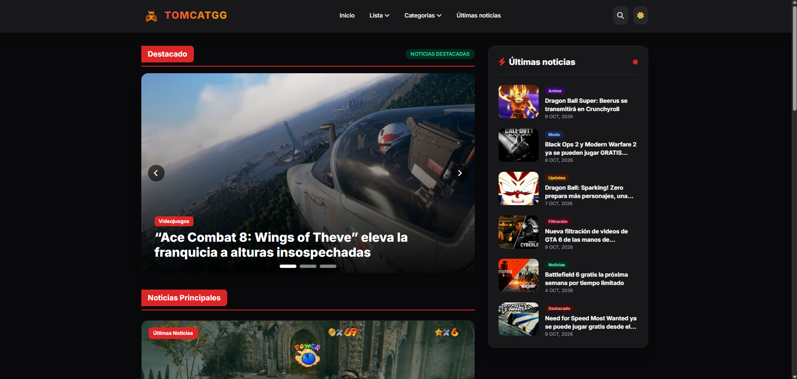
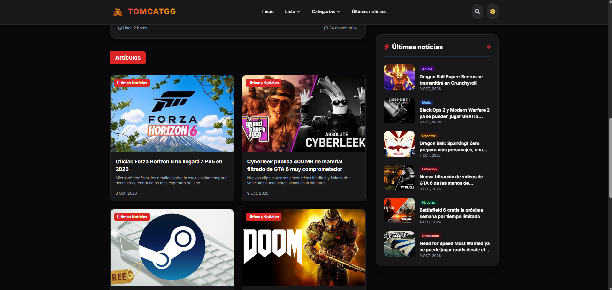

# 🎮 Portal de Noticias: Videojuegos, Anime y Mundo

¡Bienvenido a mi proyecto! Esta es una plataforma web moderna dedicada a recopilar las últimas novedades, análisis y tendencias del mundo de los **videojuegos**, el universo del **anime** y las noticias más relevantes a nivel **global**.

---

## 📸 Captura de Pantalla

Aquí puedes ver una muestra de la interfaz actual de la página:

 


 

---

## ✨ Características Principales

*   **Sección de Videojuegos:** Cobertura de lanzamientos, reseñas de la comunidad y eventos importantes de la industria.
*   **Zona Anime & Manga:** Espacio dedicado a los estrenos de la temporada, reseñas y cultura pop japonesa.
*   **Noticias del Mundo:** Un feed de actualidad general para mantenerse informado de los acontecimientos globales.
*   **Diseño Totalmente Responsivo:** Optimizado tanto para dispositivos móviles como para pantallas de escritorio.
*   **Modo Oscuro/Claro:** Interfaz cómoda y adaptada para cualquier tipo de lectura.

---

## 🛠️ Tecnologías Utilizadas

Para el desarrollo de este proyecto se han empleado las siguientes herramientas:

*   **HTML5 & JavaScript:** Estructura y dinamismo de la página.
*   **Tailwind CSS:** Framework de estilos utilizado para lograr un diseño moderno, limpio y altamente personalizable de forma eficiente.
*   **Git & GitHub:** Control de versiones y alojamiento del código fuente.

---

## 🚀 Instalación y Uso Local

Si deseas clonar este repositorio y ejecutarlo en tu computadora, sigue estos pasos:

1. Clona el repositorio:
   ```bash
   git clone https://github.com/zGattoDev/Mi-Pagina-Web-TomCat.git
   ```
2. Navega a la carpeta del proyecto:
   ```bash
   cd Mi-Pagina-Web-TomCat
   ```
3. Abre el archivo principal en tu navegador (o usa una extensión como *Live Server* en VS Code):
   ```bash
   open index.html
   ```

---
💡 *Este proyecto forma parte de mi aprendizaje continuo en FrontEnd Development. Instructor WILLY JHON CASAS RIVEROS*
